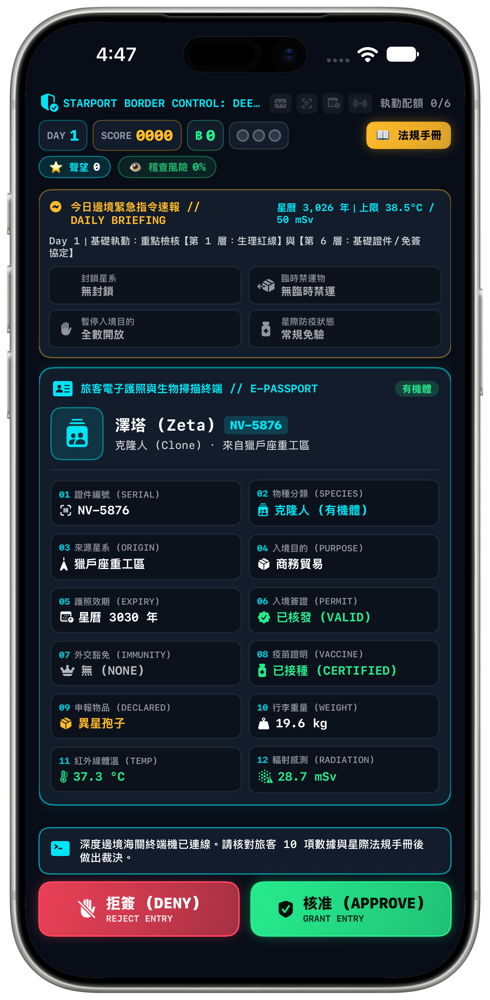
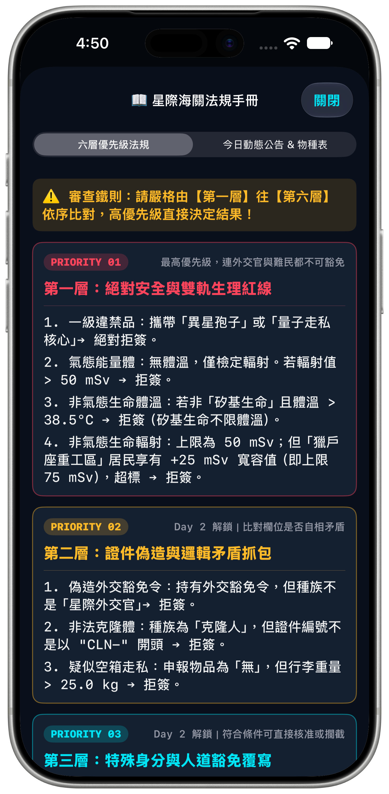
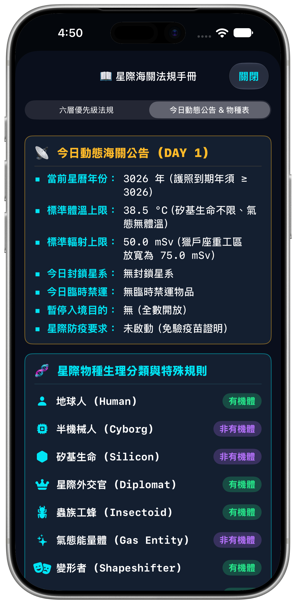
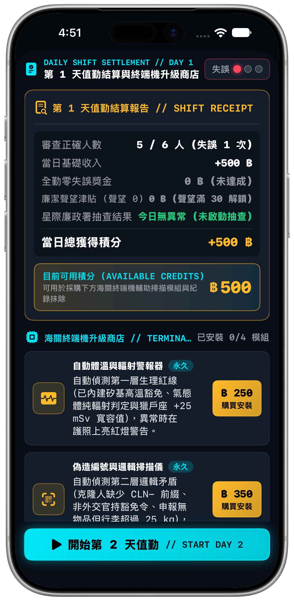
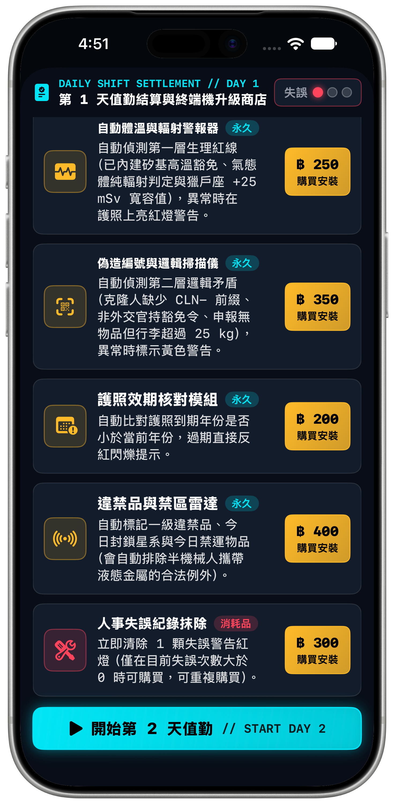

<div align="center">

# 🛸 Starport Border Control: Deep Inspection
### 星際海關審查員：深度邊境審查終端

[](#)
[](#)
[](#)
[](#)
[](#)

<p align="center">
  <b>🌐 Language / 語言切換：</b>
  <a href="#-english-version">🇺🇸 English</a> •
  <a href="#-中文版說明">🇹🇼 繁體中文</a>
</p>

</div>

---

<a id="-english-version"></a>

## 🇺🇸 English Version

> **Welcome to Star Year 3026.** You are the Chief Customs Inspector at the Interstellar Border Terminal. Cross-examine 12 biometric and passport data points against a 6-layer priority regulation funnel, catch forged IDs and smugglers, resist or accept encrypted bribes, and upgrade your terminal hardware before the Interstellar Anti-Corruption Bureau audits your records!

### 📸 Screenshots & Gameplay GIF

<div align="center">

| 🎥 Gameplay Demo (GIF) | 🖥️ Main Inspection Terminal |
| :---: | :---: |
|  |  |

| 📖 6-Layer Regulation Manual | 🧬 Dynamic Briefing & Species | 💰 Daily Settlement & Shop | 🛠️ Hardware Upgrades |
| :---: | :---: | :---: | :---: |
|  |  |  |  |

</div>

> 💡 *Tip: Place your recorded gameplay GIF and screenshots inside the `Screenshots/` folder using the filenames above (`demo.gif`, `main_terminal.png`, `manual_rules.png`, `manual_species.png`, `daily_settlement.png`, `upgrade_shop.png`).*

---

### ✨ Key Features

- ⚖️ **6-Layer Funnel Rule Engine**: Strict top-down priority evaluation (`Priority 01` to `Priority 06`). Higher-priority violations immediately override lower-level exemptions.
- 👽 **8 Distinct Interstellar Species**: Divided into **Organic** (Human, Diplomat, Insectoid, Shapeshifter, Clone) and **Non-Organic** (Cyborg, Silicon Lifeform, Gas Entity), each with unique biological and item exemptions.
- 📅 **Progressive Multi-Day Campaign**:
  - **Day 1**: Basic Duty — Layer 1 Bio-Redlines & Layer 6 Basic Permits / Visa-Free Treaties.
  - **Day 2**: Forgery, Privileges & Bribes — Unlocks Layer 2 Logic Contradictions, Layer 3 Diplomatic/Asylum Overrides, and Encrypted Bribe Transmissions.
  - **Day 3**: Interstellar Quarantine — Unlocks Layer 4 Sector Lockdowns & Mandatory Organic Vaccination Checks.
  - **Day 4+**: Full Martial Law — All 6 layers active, including Layer 5 Dynamic Embargoes, Restricted Travel Purposes, and Species-Specific Contraband.
- 🕵️‍♂️ **Morality, Bribery & Anti-Corruption Audit**:
  - Violators may send encrypted bribes (**180 ~ 550 ฿**).
  - **Accepting** grants instant credits but increases **Audit Risk (%)** and lowers **Reputation**.
  - **Reporting & Arresting** confiscates the bribe for the state, boosts Reputation (`+20`), reduces Audit Risk (`-10%`), and unlocks daily Integrity Stipends!
- 🔧 **Terminal Hardware Upgrade Shop**: Spend earned credits (`฿`) at the end of each 6-traveler shift to install permanent scanner modules or erase personnel strike records.

---

### 🏛️ The 6-Layer Priority Rule Funnel

Always inspect from **Layer 1 down to Layer 6**. The highest triggered layer determines the final verdict:

| Priority | Layer Name | Core Inspection Rules & Exemptions |
| :---: | :--- | :--- |
| 🔴 **01** | **Absolute Safety & Bio-Redlines** | • **Level-1 Contraband**: Carrying *Alien Spore* or *Quantum Core* → **Instant Deny** (No diplomatic/asylum exemptions!).<br>• **Gas Entity**: No body temperature; check radiation only (`> 50.0 mSv` → **Deny**).<br>• **Body Temp**: Non-Silicon species with temp `> 38.5°C` → **Deny** (*Silicon Lifeforms* are exempt from high temp).<br>• **Radiation**: Standard limit `50.0 mSv`. Residents of *Orion Industrial* enjoy a `+25.0 mSv` tolerance (limit `75.0 mSv`). |
| 🟠 **02** | **ID Forgery & Logic Contradictions** | • **Fake Diplomatic Immunity**: Holding Diplomatic Immunity while species is NOT *Interstellar Diplomat* → **Deny**.<br>• **Illegal Clone**: Species is *Clone* but Serial Code does NOT start with `"CLN-"` → **Deny**.<br>• **Empty-Box Smuggling**: Declared item is *None* (`無`), but baggage weight `> 25.0 kg` → **Deny**. |
| 🔵 **03** | **Special Status & Humanitarian Override** | • **Diplomatic Privilege**: Authentic *Interstellar Diplomat* with valid immunity → **Approve** (Overrides Layers 4–6).<br>• **Asylum Seeker**: Purpose is *Asylum* and carrying *None* (`無`) → **Approve** (Overrides Layers 4–6). Carrying any special item violates asylum terms → **Deny**. |
| 🟣 **04** | **Daily Emergency Directives** | • **Locked-Down Star Systems**: Traveler's origin is on today's lockdown list → **Deny**.<br>• **Suspended Travel Purpose**: Traveler's purpose matches today's suspended purpose → **Deny**.<br>• **Mandatory Quarantine**: When active, all **Organic** species without a Vaccine Certificate → **Deny**. |
| 🟡 **05** | **Controlled Items & Cross-Checks** | • **Queen Pheromone**: Restricted exclusively to *Insectoid* species → **Deny** others.<br>• **Dark Matter Battery**: Restricted exclusively to *Scientific Research* purpose → **Deny** others.<br>• **Daily Embargo List**: Carrying today's banned item → **Deny** (*Nested Exemption*: **Cyborgs** carrying *Liquid Metal* for self-maintenance are exempt and proceed to Layer 6!). |
| 🟢 **06** | **Basic Documents & Trade Treaties** | • **Passport Expiry**: Expiry year `< 3026` → **Deny**.<br>• **Entry Permit & Visa-Free Treaties**: Must hold a valid Entry Permit, UNLESS:<br>  1. Citizen of **Solar System** (Permanent Visa-Free).<br>  2. Citizen of **Sirius Trade Federation** entering for **Trade** (`商務貿易`). |

---

### 🛒 Terminal Hardware Upgrades

| Icon | Module Name | Type | Cost | Effect |
| :---: | :--- | :---: | :---: | :--- |
| 📈 | **Auto Bio-Temp & Radiation Alarm** | Permanent | `250 ฿` | Automatically flags Layer 1 bio-redlines (includes Silicon, Gas Entity, and Orion `+25 mSv` rules). |
| 🔳 | **Forgery & Logic Scanner** | Permanent | `350 ฿` | Highlights Layer 2 contradictions (`CLN-` prefix, fake immunity, `> 25 kg` empty-box smuggling). |
| 📅 | **Passport Expiry Checker** | Permanent | `200 ฿` | Flashes red warning if passport expiry year is earlier than `3026`. |
| 📡 | **Contraband & Lockdown Radar** | Permanent | `400 ฿` | Flags Level-1 contraband, locked-down origins, and embargoed items (respects Cyborg Liquid Metal exemption). |
| 🛠️ | **Personnel Strike Eraser** | Consumable | `300 ฿` | Immediately removes `1` strike warning light (purchasable when strikes `> 0`). |

---

### 📂 Project Architecture

```text
星際海關審查員/
├── MyApp.swift                 # App entry point
├── Models.swift                # Core domain models (Species, StarSystem, ContrabandItem, Traveler, UpgradeItem)
├── CustomsRuleEngine.swift     # Pure 6-layer funnel rule engine & hardware scanner alert evaluator
├── TravelerGenerator.swift     # Procedural traveler generator tailored to daily difficulty & edge cases
├── GameViewModel.swift         # @Observable state manager (progression, bribery, audit risk, shop)
├── ContentView.swift           # Cyberpunk terminal UI, 12-grid e-Passport, & interactive Regulation Manual
└── DailySummaryShopView.swift  # Daily shift receipt, Anti-Corruption audit report, & Upgrade Shop UI
```

---

<br>

<a id="-中文版說明"></a>

## 🇹🇼 中文版說明

<p align="right"><a href="#-english-version">⬆️ Back to English / 切換至英文版</a></p>

> **歡迎來到星曆 3026 年。** 您是星際邊境海關終端機的首席審查員。在每日執勤中，您必須交叉比對旅客的 **12 項電子護照與生物感測數據**，嚴格執行 **「六層漏斗式優先級法規」**，揪出偽造證件與空箱走私客、在私密行賄與廉政署稽查之間做出抉擇，並採購終端機硬體升級模組以應對全面戒嚴！

### 📸 遊戲畫面截圖與操作 GIF

<div align="center">

| 🎥 實機操作展示 (GIF) | 🖥️ 海關審查主終端機 |
| :---: | :---: |
|  |  |

| 📖 六層優先級法規手冊 | 🧬 動態公告與物種分類表 | 💰 每日值勤結算報告 | 🛠️ 終端機硬體升級商店 |
| :---: | :---: | :---: | :---: |
|  |  |  |  |

</div>

> 💡 *提示：請在專案根目錄建立 `Screenshots/` 資料夾，並將您的操作錄影 GIF 與上述截圖依檔名（`demo.gif`、`main_terminal.png`、`manual_rules.png`、`manual_species.png`、`daily_settlement.png`、`upgrade_shop.png`）放入即可完整顯示。*

---

### ✨ 核心特色

- ⚖️ **六層漏斗式規則引擎**：由【第一層】至【第六層】依序嚴格檢定，高優先級直接決定裁決結果（例如：攜帶一級違禁品時，連外交官與難民都不可豁免）。
- 👽 **8 大星際物種與雙軌生理分類**：區分為 **有機體**（地球人、星際外交官、蟲族工蜂、變形者、克隆人）與 **非有機體**（半機械人、矽基生命、氣態能量體），各自具備專屬的生理檢定邏輯與物品豁免權。
- 📈 **漸進式天數關卡設計**：
  - **Day 1｜基礎執勤**：重點檢核【第 1 層：生理紅線】與【第 6 層：基礎證件 / 免簽協定】。
  - **Day 2｜防偽、特權與行賄試探**：解鎖【第 2 層：證件偽造 / 空箱走私】、【第 3 層：外交 / 難民豁免】與【私密行賄通訊】。
  - **Day 3｜星際檢疫令**：啟用【第 4 層：緊急封鎖星系】與【有機體強制疫苗檢定】。
  - **Day 4+｜全面戒嚴**：六層法則全開！啟用【第 5 層：臨時禁運物、暫停入境目的與種族交叉限制】。
- 🕵️‍♂️ **私密行賄、廉潔聲望與星際廉政署抽查**：
  - 違規旅客有機率私下傳送加密行賄提案（賄款 **180 ~ 550 ฿**）。
  - **收賄放行**：立即獲得高額星際幣，但會大幅提升 **稽查風險 (%)** 並扣減 **聲望**（風險達 100% 或於每日結算抽查中被查獲將遭撤職逮捕）。
  - **嚴正檢舉**：沒收賄款歸公，獲得額外積分 `+150`、星際幣 `+120`、聲望 `+20` 並降低稽查風險 `-10%`；聲望滿 `30` / `60` 每日結算還可領取 **廉潔聲望津貼**！
- 🛠️ **海關終端機升級商店**：每完成 6 名旅客配額即進入每日結算，可使用星際幣（`฿`）安裝 4 種永久輔助掃描硬體模組，或購買消耗品抹除人事失誤紅燈。

---

### 🏛️ 星際海關六層優先級法規總覽

> ⚠️ **審查鐵則**：請嚴格由 **【第一層】往【第六層】** 依序比對，高優先級一旦觸發即直接決定裁決結果！

| 優先級 | 法規層級名稱 | 檢定規則與特殊豁免細節 |
| :---: | :--- | :--- |
| 🔴 **PRIORITY 01** | **第一層：絕對安全與雙軌生理紅線**<br>*(最高優先級，外交官與難民均不可豁免)* | 1. **一級違禁品**：攜帶「異星孢子」或「量子走私核心」→ **絕對拒簽**。<br>2. **氣態能量體**：無體溫概念，僅檢定輻射。若輻射值 `> 50.0 mSv` → **拒簽**。<br>3. **非氣態生命體溫**：若非「矽基生命」且體溫 `> 38.5°C` → **拒簽**（矽基生命天生高溫不限體溫）。<br>4. **非氣態生命輻射**：標準上限為 `50.0 mSv`；但「獵戶座重工區」居民享有 `+25.0 mSv` 寬容值（上限 `75.0 mSv`），超標 → **拒簽**。 |
| 🟠 **PRIORITY 02** | **第二層：證件偽造與邏輯矛盾抓包**<br>*(Day 2 解鎖｜比對欄位是否自相矛盾)* | 1. **偽造外交豁免令**：持有外交豁免令，但種族不是「星際外交官」→ **拒簽**。<br>2. **非法克隆體**：種族為「克隆人」，但證件編號不是以 `"CLN-"` 開頭 → **拒簽**。<br>3. **疑似空箱走私**：申報物品為「無」，但隨身行李重量 `> 25.0 kg` → **拒簽**。 |
| 🔵 **PRIORITY 03** | **第三層：特殊身分與人道豁免覆寫**<br>*(Day 2 解鎖｜符合條件可直接核准或攔截)* | 1. **外交特權豁免**：正統「星際外交官」且持有有效外交豁免令 → **直接核准**（豁免第 4～6 層限制）。<br>2. **星際人道庇護**：入境目的為「難民庇護」且申報物品為「無」→ **直接核准**（豁免封鎖區、簽證與過期護照）；若攜帶任何特殊管制物品則違反庇護條款 → **立即拒簽**。 |
| 🟣 **PRIORITY 04** | **第四層：每日動態緊急指令**<br>*(Day 3 解鎖｜依當日邊境速報動態攔截)* | 1. **封鎖星系攔截**：旅客來源星系位於今日緊急封鎖名單中 → **拒簽**。<br>2. **暫停入境目的**：旅客入境目的為今日緊急暫停受理之目的 → **拒簽**。<br>3. **星際強制檢疫**：當日啟動強制檢疫時，所有 **「有機體」** 物種若未持有疫苗證明 → **拒簽**（非有機體免驗）。 |
| 🟡 **PRIORITY 05** | **第五層：受控物品與種族/目的交叉檢定**<br>*(Day 4 解鎖｜含半機械人巢狀例外)* | 1. **蟲后費洛蒙**：僅限「蟲族工蜂」物種攜帶，其他物種攜帶 → **拒簽**。<br>2. **暗物質電池**：僅限「科學研究」目的攜帶，其他目的攜帶 → **拒簽**。<br>3. **今日臨時禁運品**：攜帶當日公告禁運物品 → **拒簽**。<br>   *(💡 巢狀例外：若「半機械人」攜帶被列為禁運的「液態金屬」，屬維修自用合法豁免，不在此層拒簽，繼續往下執行第六層基礎證件核對！)* |
| 🟢 **PRIORITY 06** | **第六層：基礎文件與貿易協定核對**<br>*(核對護照效期與兩大免簽協定)* | 1. **護照有效期限**：護照到期年份 `< 3026 年`（已過期）→ **拒簽**。<br>2. **入境簽證與免簽協定**：未持有有效入境簽證時，除符合以下兩大免簽協定外一律 **拒簽**：<br>   • **太陽系公民**：享有永久免簽證入境待遇。<br>   • **天狼星貿易聯邦公民**：以「商務貿易」目的入境時享有商務免簽待遇。 |

---

### 🛒 海關終端機硬體升級商店

每日完成 6 名旅客審查後，可於結算畫面使用可用積分（星際幣 `฿`）採購以下模組：

| 圖示 | 升級模組名稱 | 類型 | 價格 | 功能詳細說明 |
| :---: | :--- | :---: | :---: | :--- |
| 📈 | **自動體溫與輻射警報器** | `永久` | `฿ 250` | 自動偵測第一層生理紅線（已內建矽基高溫豁免、氣態體純輻射判定與獵戶座 `+25 mSv` 寬容值），異常時在護照欄位亮紅燈警告。 |
| 🔳 | **偽造編號與邏輯掃描儀** | `永久` | `฿ 350` | 自動偵測第二層邏輯矛盾（克隆人缺少 `CLN-` 前綴、非外交官持豁免令、申報無物品但行李超過 `25 kg`），異常時標示黃色警告橫幅。 |
| 📅 | **護照效期核對模組** | `永久` | `฿ 200` | 自動比對護照到期年份是否小於當前年份（`3026`），過期直接反紅閃爍提示。 |
| 📡 | **違禁品與禁區雷達** | `永久` | `฿ 400` | 自動標記一級違禁品、今日封鎖星系與今日禁運物品（會自動排除半機械人攜帶液態金屬的合法例外）。 |
| 🛠️ | **人事失誤紀錄抹除** | `消耗品` | `฿ 300` | 立即清除 `1` 顆失誤警告紅燈（僅在目前失誤次數 `> 0` 時可購買，可重複購買）。 |

---

### 🚀 安裝與執行方式 (Getting Started)

1. 使用 **Xcode 15.0+** 開啟專案根目錄下的 `星際海關審查員.xcodeproj`。
2. 選擇 **iPhone 15 Pro / iPhone 16 Pro**（或任何支援 **iOS 17.0+** 的模擬器與實機）。
3. 按下 `Cmd + R` 編譯並啟動星際海關審查終端機！
